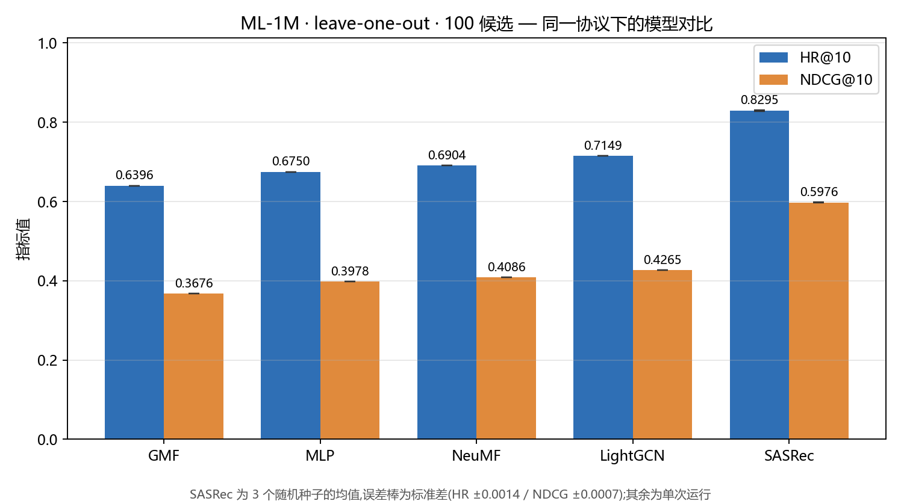

# ML-1M 统一评测协议：NCF / LightGCN / SASRec

把三个推荐模型家族钉到**同一套数据切分、同一份候选集、同一套指标**上重跑，使结果首次可以直接比较。

> 动机：NCF 报告的是「1 正 + 99 负 = 100 候选」的 HR，LightGCN 官方代码报告的是「全量物品排序」的 HR。**这两组数字不能放进同一张表**——候选集越小，HR 天然越高。要比较，必须先把口径钉死。

## 结果

**协议**：MovieLens-1M · leave-one-out（每用户最新一条为测试） · 100 候选（1 正 + 99 负） · HR@10 / NDCG@10 · 6,040 用户均值

| 模型 | 建模假设 | HR@10 | NDCG@10 | 论文报告值 |
|---|---|---|---|---|
| GMF | 集合 · 点积 | 0.6396 | 0.3676 | Figure 4 读数 ≈0.645 / ≈0.335 |
| MLP | 集合 · 非线性 | 0.6750 | 0.3978 | Figure 4 读数 ≈0.640 / ≈0.345 |
| NeuMF | 集合 · 融合 | 0.6904 | 0.4086 | **0.688 / 0.410**（Table 2, factor 8） |
| LightGCN | 图 · 邻域传播 | 0.7149 | 0.4265 | 主表未覆盖该协议（见下） |
| **SASRec** | **序列 · 自注意力** | **0.8295 ± 0.0014** | **0.5976 ± 0.0007** | **0.8235 / 0.5958** |

> SASRec 为 3 个随机种子的均值 ± 标准差（seed 42 / 2024 / 7）；其余为单次运行。



**读法**：序列建模（SASRec）比集合建模（NeuMF）高 **13.9 个百分点** HR@10；图方法（LightGCN）介于两者之间。这个排序在同一协议下才成立——如果各自照论文口径比，得不出这个结论。

**可复现性**：SASRec 三个种子的 HR 极差 0.0033、标准差 0.0014，远小于模型间差距（0.115）→ 结论不是种子运气。

## 数据对齐（这张表可信的前提）

SASRec 官方预处理版 `ml-1m.txt` 只有 999,611 行 / **3,416 个物品**（剔除了出现 <5 次的 290 个长尾物品），而 NCF 官方切分是 1,000,209 行 / **3,706 个物品**。物品空间不同 → 候选池不同 → 结果不可比。

本仓库从 NCF 官方 `train.rating + test.rating` 重建序列数据，保留全部 3,706 个物品：

```
$ python data/build_ml1m_seq.py
train=994169 test=6040 total=1000209
users=6040 items=3706
前5物品频次(应=3428/2991/2990/2883/2672): [3428, 2991, 2990, 2883, 2672]
频次<5的物品数(应=290): 290
去掉<5频次物品后行数(应=999611): 999611     ← 与上游官方预处理版精确相等
```

## 复现

```bash
# 1) 取 NCF 官方已处理的 ML-1M 切分（994169 + 6040 行），放入 lightgcn 脚本的 DATA 变量
#    https://github.com/hexiangnan/neural_collaborative_filtering  →  Data/

# 2) 重建序列数据（SASRec 用）
python data/build_ml1m_seq.py

# 3) LightGCN（本仓库实现，模型与损失与 gusye1234/LightGCN-PyTorch 一致）
python lightgcn/lightgcn_ml1m.py --epochs 300 --dim 64 --layers 3 --lr 1e-3 --reg 1e-4 --bs 2048

# 4) SASRec（上游 pmixer/SASRec.pytorch，需先按 docs/代码改动记录.md 加 --seed 参数）
cd sasrec && python main.py --dataset=ml-1m-all --train_dir=seed42 --num_epochs=200 \
    --batch_size=128 --maxlen=200 --device=cuda --seed 42

# 5) 出图与汇总
python figures/make_figures.py
```

## 目录

```
data/build_ml1m_seq.py     从 NCF 切分重建序列数据 + 一致性校验
lightgcn/lightgcn_ml1m.py  LightGCN 单文件实现（数据加载/评估改为 100 候选）
lightgcn/logs/*.tsv        逐 epoch HR@10 / NDCG@10
sasrec/                    对上游代码的改动说明
figures/                   对比图 + 生成脚本
results/summary.json       各模型 best-HR epoch 汇总
docs/代码改动记录.md        对官方实现的每一处修改与潜在影响
docs/统一协议实验报告.md     完整报告（含复现局限 vs 方法缺点）
```

## 诚实边界

- **LightGCN 不与论文数字对表**：论文主实验是 Gowalla / Yelp2018 / Amazon-Book（随机切分 + 全量排序），没有该协议下的 ML-1M 结果。本行只用于同表横向比较。
- **SASRec 略高于论文**（+0.004 HR）：物品空间不同（我们保留长尾物品），且论文用的是 5-core 过滤版数据。
- **SASRec 少用 0.6% 训练数据**：上游实现用倒数第二条做验证集选 epoch，NCF 协议无验证集。
- **LightGCN 未做超参搜索**，固定 dim 64 / 3 层 / lr 1e-3 / reg 1e-4。
- 采样指标本身的局限见 `docs/统一协议实验报告.md` 第 7 节（Krichene & Rendle, KDD 2020）。
