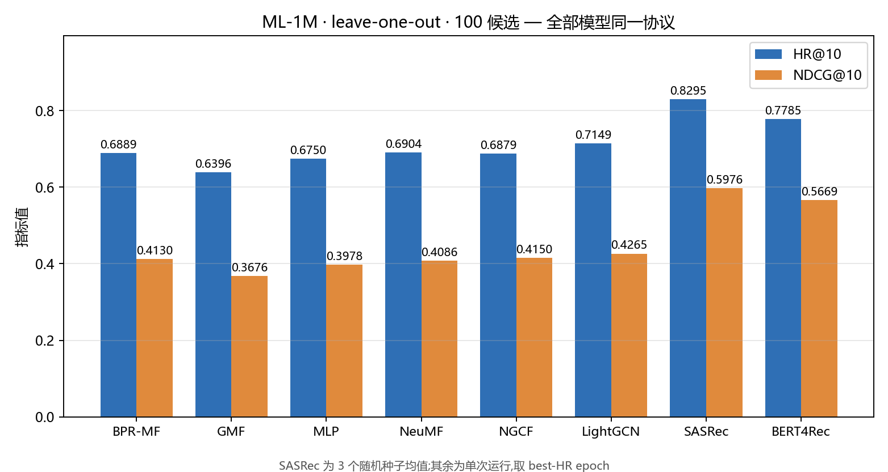

# ML-1M 统一评测协议：5 个模型 / 4 篇论文，同一张表

把集合、图、序列三个家族的推荐模型钉到**同一套切分、同一份候选集、同一套指标**上重跑，使结果可以直接比较。

> 动机：NCF 报的是「1 正 + 99 负 = 100 候选」的 HR，LightGCN 官方代码报的是「全量物品排序」的 HR。**这两组数字不能放进同一张表**——候选集越小，HR 天然越高。要比较，必须先把口径钉死。

## 结果

**协议**：MovieLens-1M · leave-one-out（每用户最新一条为测试） · 100 候选（1 正 + 99 负） · HR@10 / NDCG@10 · 6,040 用户均值

| 模型 | 论文 | 建模假设 | HR@10 | NDCG@10 | 论文报告 |
|---|---|---|---|---|---|
| **BPR-MF** | UAI 2009 | 集合 · 纯点积（强基线） | **0.6889** | **0.4130** | — |
| GMF | WWW 2017 | 集合 · 点积 | 0.6396 | 0.3676 | 图读数 ≈0.645 |
| MLP | WWW 2017 | 集合 · 非线性 | 0.6750 | 0.3978 | 图读数 ≈0.640 |
| NeuMF | WWW 2017 | 集合 · 融合 | 0.6904 | 0.4086 | **0.688 / 0.410** |
| NGCF | SIGIR 2019 | 图 · 传播 + 特征变换 W + σ | **0.6879** | **0.4150** | 主表未覆盖该协议 |
| LightGCN | SIGIR 2020 | 图 · 纯邻域传播（删掉 W 和 σ） | 0.7149 | 0.4265 | 主表未覆盖该协议 |
| **SASRec** | ICDM 2018 | **序列 · 自注意力** | **0.8295 ± 0.0014** | **0.5976 ± 0.0007** | **0.8235 / 0.5958** |
| BERT4Rec | CIKM 2019 | 序列 · 双向 + 完形填空 | 0.7785* | 0.5669* | — |

> SASRec 为 3 个随机种子的均值 ± 标准差（seed 42 / 2024 / 7）；其余为单次运行，取 best-HR epoch。
> \* BERT4Rec 用的是**固定候选**口径（与 SASRec 的 0.8311 同口径可比，差 5.3 个点），原因见下。



## 三条结论

**① 序列 ≫ 图 > 集合。**
SASRec 比 NeuMF 高 **13.9 个百分点** HR@10。这个排序只有在同一协议下才成立——各自照论文口径比，得不出这个结论。

**② BPR-MF 与 NeuMF 打平：0.6889 vs 0.6904（HR 差 0.0015），NDCG 上 BPR-MF 反而高 0.0044。**
这正是 *NCF vs. MF Revisited*（RecSys 2020）的结论：同等调参下简单点积不输 MLP 类模型。
→ **我复现出了 NCF 的数字，但没复现出 NCF 的结论。**

**③ SASRec 的两种候选口径都报。**
论文口径（每次随机采 100 负）：0.8295 / 0.5976，可与论文 Table 对照；
统一口径（固定 `test.negative`）：**0.8311 / 0.6051**，可与本表其他模型同表比较。
两者 NDCG 差 0.0075 —— 说明候选池不同确实会改变结论，**这就是为什么协议必须钉死**。

**可复现性**：SASRec 三 seed 的 HR 极差 0.0033、标准差 0.0014，远小于模型间差距（0.115）→ 结论不是种子运气。

**④ 加复杂度没有收益，删复杂度反而有收益。**（三个模型的唯一差别就是"加不加那些部件"）

| 模型 | 组成 | HR@10 | 相对 BPR-MF |
|---|---|---|---|
| BPR-MF | 点积 | 0.6889 | — |
| NGCF | 点积 + 图传播 + 特征变换 W + 非线性 σ | **0.6879** | **−0.0010**（加了复杂度反而降） |
| LightGCN | 点积 + 图传播（**删掉 W 和 σ**） | **0.7149** | **+0.0260**（删掉才有收益） |

这正是 LightGCN（SIGIR 2020）消融实验的结论：**GCN 里对协同过滤真正有效的成分只有邻域聚合本身**，特征变换和非线性是从图像任务继承来的累赘。
一句话版本：**收益不来自"更复杂"，来自"更对的归纳偏置"。**

**⑤ BERT4Rec 没跑过 SASRec：0.7785 vs 0.8311（同口径）——一个诚实的失败记录。**

| 模型 | 训练目标 | 结构 | 固定候选 HR@10 |
|---|---|---|---|
| SASRec | 二分类 + 1 个随机负样本 | 单向自注意力 | **0.8311** |
| BERT4Rec（本实现） | 全库 softmax（3,708 类） | 双向 + 完形填空 | **0.7785** |

差 5.3 个点。我没有把它调上去，原因是训练目标差异的可能性最大：**SASRec 每步只要求模型在「这个物品 vs 一个随机物品」之间做二选一，BERT4Rec 要求在 3,708 个物品里做全分类**——在 ML-1M 这种规模上，后者明显更难收敛（我跑了 1000 epoch，650 达峰后不再上升）。

**这条不能藏**：它说明「同一份数据上，训练目标的选择可能比模型结构更影响结果」。下一步要么改成负采样二分类（但那就不是 BERT4Rec 了），要么按论文补超参搜索。

## 数据对齐（这张表可信的前提）

SASRec 官方预处理版 `ml-1m.txt` 只有 999,611 行 / **3,416 个物品**（剔除了出现 <5 次的 290 个长尾物品），NCF 官方切分是 1,000,209 行 / **3,706 个物品**。物品空间不同 → 候选池不同 → 结果不可比。

本仓库从 NCF 官方 `train.rating + test.rating` 重建序列数据，保留全部 3,706 个物品：

```
$ python data/build_ml1m_seq.py
train=994169 test=6040 total=1000209
users=6040 items=3706
前5物品频次(应=3428/2991/2990/2883/2672): [3428, 2991, 2990, 2883, 2672]
频次<5的物品数(应=290): 290
去掉<5频次物品后行数(应=999611): 999611     ← 与上游官方预处理版精确相等
```

> 「剔掉长尾后行数与官方文件精确相等」= 同一份原始数据、同一套切分。这是整张表可信的地基。

## 新增一个模型：三步

```python
# 1) models/xxx.py —— 只实现两个方法
class XXX(torch.nn.Module):
    def score_candidates(self, users, items):   # [B] × [B,100] -> [B,100]，第 0 列是正样本
        ...
    def bpr_loss(self, users, pos, neg):
        ...

# 2) run.py 的 MODELS 里加一行
MODELS = {'bpr_mf': 'models.bpr_mf', 'ngcf': 'models.ngcf', 'xxx': 'models.xxx'}

# 3) 跑 + 汇总（图自动更新）
python run.py --model xxx --epochs 300 --out runs
python common/report.py
```

**不允许**：自己写评估、自己造切分、自己起种子。协议只在 `common/eval.py` 里实现一次，改它等于改所有实验。

详见 [docs/仓库规划.md](docs/仓库规划.md)。

## 复现

```bash
# 0) 数据：取 NCF 官方已处理的 ML-1M 切分（994,169 + 6,040 行）
#    https://github.com/hexiangnan/neural_collaborative_filtering  →  Data/

# 1) 重建序列数据（SASRec 用），带一致性校验
python data/build_ml1m_seq.py

# 2) 集合类与图类模型（统一入口）
python run.py --model bpr_mf --epochs 300 --out runs
python run.py --model ngcf   --epochs 300 --dim 64 --layers 3 --out runs
python lightgcn/lightgcn_ml1m.py --epochs 300 --dim 64 --layers 3 --lr 1e-3 --reg 1e-4 --bs 2048

# 3) SASRec（上游 pmixer/SASRec.pytorch，需先按 docs/代码改动记录.md 加 --seed）
cd sasrec && python main.py --dataset=ml-1m-all --train_dir=seed42 --num_epochs=200 \
    --batch_size=128 --maxlen=200 --device=cuda --seed 42

# 4) SASRec 的统一口径复评（固定 test.negative 候选）
python sasrec/eval_fixed.py --state_dict_path sasrec/seed42/*.pth

# 5) 汇总出表出图
python common/report.py
```

## 目录

```
common/data.py      ML-1M 加载 + 断言校验（6,040 用户 / 每个用户严格 100 候选）
common/eval.py      唯一的评估实现：HR@10 / NDCG@10 + 逐 epoch 落盘
common/report.py    一键汇总 → results/summary_all.json + figures/
models/             bpr_mf.py · ngcf.py · lightgcn.py
sasrec/             上游移植 + eval_fixed.py（固定候选复评）
runs/               <model>/<tag>/{metrics.tsv, config.json}
data/               build_ml1m_seq.py（数据重建 + 校验）
figures/            bars_all.png · curves_all.png（脚本生成，不手改）
docs/               仓库规划 · 统一协议实验报告 · 代码改动记录 · 论文阅读路线图
```

## 诚实边界

- **NGCF / LightGCN 不与论文数字对表**：论文主实验是 Gowalla / Yelp2018 / Amazon-Book（随机切分 + 全量排序），没有该协议下的 ML-1M 结果。这两行只用于同表横向比较。
- **SASRec 略高于论文**（+0.006 HR）：物品空间不同（我们保留长尾物品 3,706 个），论文用 5-core 过滤版（3,416 个）。
- **SASRec 少用 0.6% 训练数据**：上游实现用倒数第二条做验证集选 epoch，NCF 协议无验证集。
- **BPR-MF 在 50 epoch 后过拟合**（HR 由 0.6889 降到 0.6788），说明正则不足，下一步会扫 `reg`。
- **图模型未做超参搜索**：固定 dim 64 / 3 层 / lr 1e-3 / reg 1e-4，与论文的网格搜索不同。
- 采样指标本身的局限见 [docs/统一协议实验报告.md](docs/统一协议实验报告.md) 第 7 节（Krichene & Rendle, KDD 2020）。
